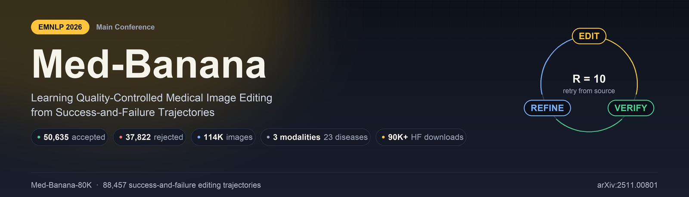
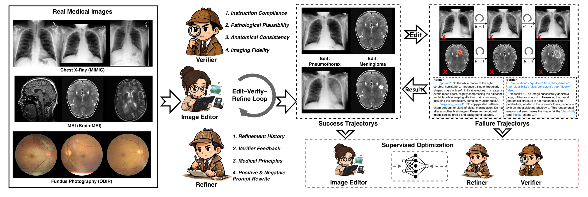

<p align="center">
  
</p>

<h1 align="center">Med-Banana: Learning Quality-Controlled Medical Image Editing<br>from Success-and-Failure Trajectories</h1>

<p align="center">
  <a href="https://2026.emnlp.org/"></a>
  <a href="https://arxiv.org/abs/2511.00801"></a>
  <a href="https://huggingface.co/datasets/RichardChenZH/Med-Banana-80K"></a>
  <a href="https://huggingface.co/datasets/RichardChenZH/Med-Banana-80K"></a>
  <a href="LICENSE"></a>
  <a href="https://github.com/richardChenzhihui/Med-Banana-80K/stargazers"></a>
</p>

<p align="center">
  <b>Zhihui Chen</b><sup>1</sup> &nbsp;·&nbsp;
  <b>Qingyuan Lei</b><sup>2</sup> &nbsp;·&nbsp;
  <b>Kai He</b><sup>1</sup>&#42; &nbsp;·&nbsp;
  <b>Yanrui Du</b><sup>3</sup> &nbsp;·&nbsp;
  <b>Mengling Feng</b><sup>1</sup><br>
  <sup>1</sup>National University of Singapore &nbsp;
  <sup>2</sup>The Chinese University of Hong Kong &nbsp;
  <sup>3</sup>Harbin Institute of Technology<br>
  <sub>&#42;Corresponding author</sub>
</p>

Official code release for our **EMNLP 2026** paper *Med-Banana: Learning Quality-Controlled Medical Image Editing from Success-and-Failure Trajectories* ([arXiv:2511.00801](https://arxiv.org/abs/2511.00801)).

This repository contains everything needed to reproduce Med-Banana end to end: the Gemini-based pipeline that constructed **Med-Banana-80K** (`dataset_construction/`), the editor / verifier / refiner training code (`medbanana-train/`, `finetune/`), the edit–verify–refine inference runtime (`verify-refine-loop/`), and the evaluation suite (`inference/`) behind every number in the paper.

> **This is a code-only release.** No medical images are bundled with the repository. Download the dataset from [🤗 Med-Banana-80K](https://huggingface.co/datasets/RichardChenZH/Med-Banana-80K) and point the scripts at your local copy — see [Getting the data](#getting-the-data).

## News

- **2026-08** — EMNLP 2026 camera-ready release. The dataset is renamed **Med-Banana-50K → Med-Banana-80K**, and this repository now ships the full editor / verifier / refiner training, edit–verify–refine inference, and evaluation code that was previously available only to reviewers.
- **2026-02** — Full dataset release on the Hugging Face Hub: 114,093 image records, 50,635 accepted edits, 37,822 rejected attempts with verifier rationales.

## Overview



Text-guided medical image editing has to satisfy the requested pathology *and* preserve anatomy, modality-specific appearance, and clinical plausibility. Existing datasets supervise editors with **final accepted edits only** and discard everything that failed along the way. Med-Banana argues the opposite: the failures are the supervision that teaches quality control — they record what should be rejected, *why* an edit is medically or visually invalid, and *how* the instruction should be revised.

The system couples three modules trained on those trajectories:

| Module | Backbone | Trained on | Role |
|---|---|---|---|
| **Editor** | Qwen-Image-Edit-2511 / FireRed-Image-Edit-1.1 (LoRA) | accepted trajectories | produce a candidate edit from the source image and current prompt |
| **Verifier** | Qwen3.5-9B (SFT) | accepted + rejected trajectories | judge instruction compliance, pathological plausibility, anatomical consistency, imaging fidelity |
| **Refiner** | Qwen3.5-9B (SFT) | rejected trajectories + verifier rationales | rewrite the prompt / negative prompt for the next attempt |

At inference the loop runs with a refinement budget of **R = 10**, and every retry re-edits **the original source image** rather than the previous failed candidate — so artifacts never accumulate across rounds while verifier feedback still steers the next attempt.

## Hugging Face resources

| Resource | Link | Notes |
|---|---|---|
| **Med-Banana-80K** (full dataset) | [RichardChenZH/Med-Banana-80K](https://huggingface.co/datasets/RichardChenZH/Med-Banana-80K) | 114,093 image records · 90K+ downloads · images **CC BY 4.0**, metadata **ODC-By 1.0** |

Trained editor LoRA / verifier / refiner checkpoints are not mirrored on the Hub yet. Train them with the steps below (the paper's full run is ~10 h on 8×H100 for all three modules), or watch this repository.

## Abstract

> Text-guided medical image editing must satisfy the requested pathology while preserving anatomy, modality-specific appearance, and clinical plausibility. However, existing datasets largely supervise editors with final accepted edits and discard the failed attempts produced during generation. We argue that these failures provide essential supervision for quality control: they specify what should be rejected, why an edit is medically or visually invalid, and how the instruction should be revised. We present **Med-Banana**, a trajectory-supervised framework for quality-controlled medical image editing. We introduce **Med-Banana-80K**, a large-scale resource of success-and-failure editing trajectories with candidate images, verification outcomes, rejection reasons, and prompt refinements. Building on it, Med-Banana jointly trains an editor, verifier, and refiner, enabling edit–verify–refine inference from accepted and rejected attempts. Experiments across MLLM judges, blind expert assessment, source-preservation and real–synthetic separability probes demonstrate consistent improvements over open medical image editors.

## Repository layout

```text
Med-Banana-80K/
├── dataset_construction/          # Gemini pipeline that built Med-Banana-80K
│   ├── add_disease.py             #   normal  -> diseased  (edit-verify-refine, LLM-as-Judge)
│   └── remove_disease.py          #   diseased -> normal   (mirror of the above)
├── medbanana-train/scripts/       # editor LoRA
│   ├── flymayai-script/prepare_medbanana_qwen_edit_dataset.py   # success_edit.jsonl -> DiffSynth triplets
│   └── diffsynth/                 # train_medbanana_edit.sh, LoRA merge + checkpoint validation
├── finetune/                      # verifier / refiner SFT
│   ├── build_vlm_sft_from_conversations.py   # trajectory logs -> VLM SFT JSON (maintainer tool)
│   ├── check_vlm_dataset_images_exist.py     # validate every images[] path resolves
│   ├── rewrite_vlm_paths_for_training.py     # rewrite images[] to absolute paths for training
│   └── scripts/                   # ms-swift `swift sft` / `swift export` wrappers
├── verify-refine-loop/runtime/    # the edit-verify-refine system
│   ├── scheduler.py               #   multi-round scheduler (core of the paper)
│   ├── prompts.py                 #   verifier / refiner prompt templates
│   ├── edit_server.py             #   FastAPI wrapper around the DiffSynth editor
│   ├── build_inference_set.py     #   stratified addition/removal inference sets
│   ├── build_smoke_set.py         #   small smoke set from a prepared editor dataset
│   ├── config.{example,r10,r20}.json          # R=5 / R=10 / R=20 run configurations
│   └── start-*.sh                 #   vLLM, edit-server and scheduler launchers
├── inference/                     # evaluation
│   ├── mllm-judge/                #   MedGemma-27B and MiMo-V2.5 judges
│   ├── obj-metric/                #   PSNR / LPIPS, ResNet-18/34 real-vs-synthetic probes
│   ├── human-as-judge-v2/         #   blind two-expert scoring GUI (Gradio)
│   ├── gemini/, openai/           #   proprietary-baseline batch runners
│   └── raw-output-with-failure/analyze_refine_trajectories.py   # refinement-trajectory analysis
├── models/                        # place downloaded checkpoints here (gitignored)
├── docs/
│   ├── prompt-flow.md             # deep dive on the multi-round prompt / gating logic
│   └── data-format.md             # Med-Banana-80K record schemas
└── assets/                        # README figures
```

## Getting the data

```bash
pip install -U "huggingface_hub[cli]"
hf download RichardChenZH/Med-Banana-80K --repo-type dataset --local-dir ./Med-Banana-80K
export MEDBANANA_ROOT="$(pwd)/Med-Banana-80K"
```

The downloaded tree contains `metadata.jsonl`, `success_edit.jsonl` (50,635 rows), `failed_edit.jsonl` (37,822 rows) and `data/{modality}/images/{real,addition,removal,failed}/`. Record schemas are documented in [`docs/data-format.md`](docs/data-format.md).

Every script that needs the dataset takes it explicitly — `--medbanana-root` for the preparation scripts, `$MEDBANANA_ROOT` for the objective-metric probes. Nothing falls back to a bundled copy.

## Environment setup

### 1. Python dependencies

```bash
git clone https://github.com/richardChenzhihui/Med-Banana-80K.git
cd Med-Banana-80K
pip install -r requirements.txt
```

Install PyTorch with the CUDA build that matches your platform separately.

### 2. External training / serving stacks

| Component | Used for | Notes |
|---|---|---|
| [DiffSynth-Studio](https://github.com/modelscope/DiffSynth-Studio) | editor LoRA training + edit server | clone beside this repo or set `DIFFSYNTH_STUDIO_ROOT` |
| [ms-swift](https://github.com/modelscope/ms-swift) | verifier / refiner SFT | `swift sft` wrappers live in `finetune/scripts/` |
| [vLLM](https://github.com/vllm-project/vllm) | serving the verifier / refiner | `verify-refine-loop/runtime/start-vllm-*.sh` |
| [google-genai](https://github.com/googleapis/python-genai) | dataset construction | already in `requirements.txt` |

### 3. Model checkpoints

Download the base models into [`models/`](models/README.md), then:

```bash
export LOCAL_MODELS_ROOT="$(pwd)/models"
export BASE_MODEL="${LOCAL_MODELS_ROOT}/Qwen3.5-9B"
```

## Dataset construction pipeline

`dataset_construction/` holds the two scripts that generated Med-Banana-80K from real clinical images. Each source image runs through the same edit → verify → refine loop: a reasoning model writes (and later revises) the editing prompt, an image model performs the edit, and the reasoning model acts as LLM-as-Judge over instruction compliance, structural plausibility, realism and fidelity. Accepted candidates become success trajectories; rejected ones are kept with their reason and the refined prompt.

```bash
export GOOGLE_API_KEY="YOUR_API_KEY"
```

**Input layout** — you must lay out your own source images this way; nothing is auto-created:

```text
dataset_construction/full-data/<dataset-name>/
├── normal/          # healthy source images
├── <disease-A>/     # diseased source images, one folder per pathology
└── <disease-B>/
```

The `<dataset-name>` matters: the modality description sent to the model is keyword-matched from it. Use a name containing `mimic` or `chest` (→ *chest X-ray*), `brain` or `tumor` (→ *brain MRI*), or `odir` or `fundus` (→ *fundus*); anything else falls back to a generic "medical" description.

**Add a pathology** (normal → diseased):

```bash
cd dataset_construction
python add_disease.py --dataset Chest-XRay --max-workers 20 --max-rounds 5
```

**Remove a pathology** (diseased → normal):

```bash
python remove_disease.py --dataset Chest-XRay --max-workers 20 --max-rounds 5
```

Both write to `dataset_construction/<dataset-name>-edit/` (or `-remove/`) alongside `progress.json` (resume support — re-running skips completed tasks), `final_prompts.json`, `all_conversations.json`, and `api_failures.json`. Rejected candidates and their full conversation land in `<dataset-name>-edit-failed/`.

The model IDs used to build the released corpus are the defaults and can be overridden:

```bash
python add_disease.py --dataset Chest-XRay \
  --editor-model gemini-2.5-flash-image-preview \
  --verifier-model gemini-2.5-pro
```

`--editor-model` is the image-editing model (the API id of the editor released under the *Nano Banana* name); `--verifier-model` is the reasoning model used for prompt generation, prompt refinement and verification.

## Med-Banana-80K

| | |
|---|---:|
| Real clinical source images | 25,636 |
| Modalities | 3 (chest X-ray, brain MRI, fundus) |
| Pathological categories | 23 |
| Success trajectories | 50,635 |
| Failure trajectories | 37,822 |
| Total editing attempts | 88,457 |
| Total image records | 114,093 |

Source datasets: **MIMIC-CXR** (chest X-ray), **Brain Tumor MRI** (brain MRI), **ODIR-5K** (fundus).

## Editor LoRA training (DiffSynth)

Prepare editor triplets from the downloaded dataset:

```bash
python medbanana-train/scripts/flymayai-script/prepare_medbanana_qwen_edit_dataset.py \
  --medbanana-root "$MEDBANANA_ROOT" \
  --out-root medbanana-train/data \
  --sizes 10
```

Smoke training:

```bash
export DIFFSYNTH_STUDIO_ROOT=/path/to/DiffSynth-Studio
export LOCAL_MODELS_ROOT="$(pwd)/models"
export CUDA_VISIBLE_DEVICES=0

bash medbanana-train/scripts/diffsynth/medbanana_qwen_edit_10samples.sh     # Qwen backbone
bash medbanana-train/scripts/diffsynth/medbanana_firered_edit_10samples.sh  # FireRed backbone
```

Checkpoints are written under `${DIFFSYNTH_STUDIO_ROOT}/models/train/medbanana/`. Validate a checkpoint without a GPU with `medbanana-train/scripts/diffsynth/medbanana_validate_diffsynth_lora_ckpt.py`.

## Verifier & refiner SFT (ms-swift)

Build the VLM SFT JSON from raw trajectory logs (maintainer tool — needs the raw conversation logs, which are not part of the public release):

```bash
python finetune/build_vlm_sft_from_conversations.py \
  --medbanana-root /path/to/raw/publish/tree \
  --out-dir finetune/data
python finetune/check_vlm_dataset_images_exist.py \
  --publish-root /path/to/raw/publish/tree \
  --prompt-json finetune/data/vlm_prompt_generation_dataset.json \
  --verify-json finetune/data/vlm_verification_dataset.json
```

Train the verifier:

```bash
export BASE_MODEL="${LOCAL_MODELS_ROOT}/Qwen3.5-9B"
export DATASET_JSON="$(pwd)/finetune/data/vlm_verification_dataset.json"
export OUTPUT_DIR="$(pwd)/finetune/output/vlm_verification"
bash finetune/scripts/train_vlm_verification.sh
```

Train the refiner (prompt generation):

```bash
export DATASET_JSON="$(pwd)/finetune/data/vlm_prompt_generation_dataset.json"
export OUTPUT_DIR="$(pwd)/finetune/output/vlm_prompt_generation"
bash finetune/scripts/train_vlm_prompt_generation.sh
```

Merge a LoRA adapter into a deployable checkpoint:

```bash
export ADAPTER_PATH=/path/to/verifier/checkpoint
export MERGED_MODEL_PATH="${LOCAL_MODELS_ROOT}/Qwen3.5-9B-prompt-verifier"
bash finetune/scripts/merge_model.sh
```

## Edit–verify–refine inference

Build an inference set, then edit `verify-refine-loop/runtime/config.example.json` so `refiner.model`, `verifier.model` and `output_root` match your environment. Relative `output_root` values are resolved against the repository root.

```bash
python verify-refine-loop/runtime/build_inference_set.py \
  --medbanana-root "$MEDBANANA_ROOT" \
  --out-root inference/data --n 100
```

Start the services in separate terminals:

```bash
bash verify-refine-loop/runtime/start-vllm-refiner.sh      # 1) vLLM refiner
bash verify-refine-loop/runtime/start-vllm-verifier.sh     # 2) vLLM verifier

export LORA_PATH=/path/to/qwen_edit_medbanana/epoch-0.safetensors
bash verify-refine-loop/runtime/start-edit-qwen.sh         # 3) DiffSynth edit server

DRY_RUN=1 bash verify-refine-loop/runtime/start-scheduler.sh   # 4) dry run
bash verify-refine-loop/runtime/start-scheduler.sh             #    real run
```

`start-scheduler-r10.sh` and `start-scheduler-r20.sh` reproduce the R = 10 and R = 20 ablation settings. Outputs land under `verify-refine-loop/outputs/` with per-backend traces (`progress.json`, `all_conversations.json`, `edit-traces/`). The full round-by-round prompt and gating logic is documented in [`docs/prompt-flow.md`](docs/prompt-flow.md).

## Evaluation

**MLLM-as-Judge — MedGemma-27B** (OpenAI-compatible server):

```bash
export MEDGEMMA_SERVER_URL=http://127.0.0.1:8080/v1
export MEDGEMMA_MODEL=medgemma-27b-it
python inference/mllm-judge/run_mllm_judge-medgemma.py --dry-run
```

**MLLM-as-Judge — MiMo-V2.5**:

```bash
export MIMO_SERVER_URL=https://<your-openai-compatible-endpoint>/v1
export MIMO_API_KEY=your_key
python inference/mllm-judge/run_mllm_judge-mimo.py --dry-run
```

**Objective metrics** (PSNR / LPIPS + ResNet-18/34 real-vs-synthetic probes). Requires edited outputs under `inference/result/<model>/edit/`:

```bash
export MEDBANANA_ROOT=/path/to/Med-Banana-80K
cd inference/obj-metric && python run_all.py
```

**Blind two-expert scoring GUI**, matching the paper's human evaluation protocol:

```bash
cd inference/human-as-judge-v2
python eval_gui.py --prepare
python eval_gui.py --check
python eval_gui.py --port 7861
```

**Refinement-trajectory analysis** (failure dimensions per round, rounds-until-acceptance):

```bash
python inference/raw-output-with-failure/analyze_refine_trajectories.py \
  --qwen-root verify-refine-loop/output-r10/qwen2511 \
  --firered-root verify-refine-loop/output-r10/firered11
```

## Results

**MLLM-as-Judge (MedGemma-27B), overall average.** Both Med-Banana variants improve their own base editor, which is the controlled comparison that matters.

| Model | Overall | Rank |
|---|:---:|:---:|
| GPT-Image-2 | 8.01 | 1 |
| **Med-Banana (Qwen)** | **7.93** | 2 |
| **Med-Banana (FireRed)** | **7.93** | 2 |
| Nano-Banana-2 | 7.89 | 4 |
| Nano-Banana | 7.88 | 5 |
| Qwen-Image-Edit (base) | 7.77 | 6 |
| FireRed-Image-Edit (base) | 7.69 | 7 |

**Objective probes.** Average rank across LPIPS, PSNR and ResNet-18/34 real-vs-synthetic separability: **Med-Banana (FireRed) 1.50** (best overall), **Med-Banana (Qwen) 2.75** — ahead of their base editors at 5.50 and 3.50.

Trajectory supervision improves open editors by up to **+1.27** under the MLLM judge and **+0.84** under blind expert assessment. Full tables, ablations (component removal, refinement budget R ∈ {0, 1, 5, 10, 20}), unseen-disease generalisation and MedSigLIP disease-signal results are in the [paper](https://arxiv.org/abs/2511.00801).

## Path configuration

| Variable | Purpose |
|---|---|
| `MEDBANANA_ROOT` | Local Med-Banana-80K download |
| `LOCAL_MODELS_ROOT` | Base diffusion / VLM weights (`models/`) |
| `DIFFSYNTH_STUDIO_ROOT` | DiffSynth-Studio clone |
| `BASE_MODEL` | ms-swift SFT base model |
| `LORA_PATH` | Editor LoRA for the edit server |
| `GOOGLE_API_KEY` | Gemini API key for `dataset_construction/` |
| `MIMO_SERVER_URL`, `MIMO_API_KEY` | MiMo-V2.5 judge endpoint and key |
| `MEDGEMMA_SERVER_URL`, `MEDGEMMA_MODEL` | MedGemma judge endpoint and model id |
| `OPENAI_API_KEY` | GPT-Image-2 baseline batch runner |

All scripts otherwise default to paths relative to this repository.

## Intended use and ethics

Med-Banana and Med-Banana-80K are released **for research and education only** — medical image editing and quality-control research, expert-supervised teaching with counterfactual image pairs, robustness testing, and augmentation studies validated on real clinical data.

Because the corpus edits real clinical images, the main risk is that an edited image is presented as authentic patient data. Every released record therefore retains its edit provenance, a non-identifying source-dataset key, the target pathology and its trajectory metadata, so edited images remain traceable to their synthetic origin.

The dataset is **not** designed for clinical diagnosis, treatment, or use as patient evidence. Any use in training or evaluating clinical systems requires independent validation on real, patient-disjoint external data. The released subset also lacks the demographic detail needed for subgroup analyses.

## License

Code in this repository is released under the **MIT License** — see [`LICENSE`](LICENSE).

The **Med-Banana-80K** dataset is distributed separately on the Hugging Face Hub: images under **CC BY 4.0**, metadata under **ODC-By 1.0**. Refer to the [dataset card](https://huggingface.co/datasets/RichardChenZH/Med-Banana-80K) for the authoritative terms.

The underlying source datasets keep their own licenses and access conditions, which take precedence over anything stated here:

- [MIMIC-CXR](https://physionet.org/content/mimic-cxr/2.0.0/) — credentialed access via PhysioNet, governed by its data use agreement
- [Brain Tumor MRI Dataset](https://www.kaggle.com/datasets/masoudnickparvar/brain-tumor-mri-dataset)
- [ODIR-5K](https://www.kaggle.com/datasets/andrewmvd/ocular-disease-recognition-odir5k)

## Citation

```bibtex
@inproceedings{chen2026medbanana,
  title     = {Med-Banana: Learning Quality-Controlled Medical Image Editing from Success-and-Failure Trajectories},
  author    = {Chen, Zhihui and Lei, Qingyuan and He, Kai and Du, Yanrui and Feng, Mengling},
  booktitle = {Proceedings of the 2026 Conference on Empirical Methods in Natural Language Processing},
  year      = {2026},
  eprint    = {2511.00801},
  archivePrefix = {arXiv},
  url       = {https://arxiv.org/abs/2511.00801}
}
```

**Reference:** Zhihui Chen, Qingyuan Lei, Kai He, Yanrui Du, Mengling Feng. *Med-Banana: Learning Quality-Controlled Medical Image Editing from Success-and-Failure Trajectories.* EMNLP 2026. [arXiv:2511.00801](https://arxiv.org/abs/2511.00801)

## Acknowledgements

Med-Banana-80K is built on [MIMIC-CXR](https://physionet.org/content/mimic-cxr/2.0.0/), the [Brain Tumor MRI Dataset](https://www.kaggle.com/datasets/masoudnickparvar/brain-tumor-mri-dataset) and [ODIR-5K](https://www.kaggle.com/datasets/andrewmvd/ocular-disease-recognition-odir5k). Training and inference build on [DiffSynth-Studio](https://github.com/modelscope/DiffSynth-Studio), [ms-swift](https://github.com/modelscope/ms-swift) and [vLLM](https://github.com/vllm-project/vllm). Thanks to everyone who filed issues and pull requests against the original Med-Banana-50K release.
