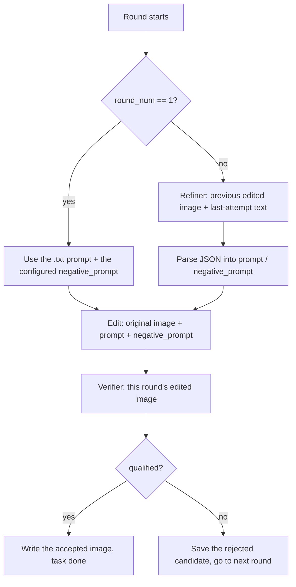

# Verify–refine loop: prompts and the multi-round flow

This document describes the full chain of **prompt generation, hand-off, parsing, editing and verification** implemented in `verify-refine-loop/runtime/prompts.py` and `verify-refine-loop/runtime/scheduler.py`. The code is the source of truth; this file follows it.

---

## 1. Participants

| Role | Where | What it does |
|---|---|---|
| **Initial prompt** | `<stem>.txt` in the input directory | The round-1 editing instruction. Never passes through the refiner. |
| **Refiner** | vLLM + `Qwen3.5-9B-prompt-refiner` | From round 2 on, rewrites `prompt` + `negative_prompt` using the previous round's failure. |
| **Edit server** | `edit_server.py` → DiffSynth `QwenImagePipeline` | Applies the positive/negative prompt pair to the **original** source image. |
| **Verifier** | vLLM + `Qwen3.5-9B-prompt-verifier` | Scores **this round's edited image** and decides whether the loop can stop early. |

Task type is parsed from the file stem:

- `addition` — **add** a pathology to a normal image → output directory suffix `edit`
- `removal` — **remove** a pathology from a diseased image → output directory suffix `remove`

---

## 2. The three steps inside one round

Every round `round_num` runs in this fixed order:



---

## 3. Which image each step sees (important)

| Step | Image sent to the VLM / editor | Note |
|---|---|---|
| Refiner (round ≥ 2) | **previous round's edited image** (JPEG bytes) | `prev_edited_image_bytes` — not the source image |
| Edit | **original control image** (`task.image_path`) | every round edits the same base image; edits are never chained |
| Verifier | **this round's edited image** (JPEG bytes) | `edited_image_bytes` |

The design consequence: the refiner and verifier reason about *what the edit currently looks like*, while diffusion always retries a different prompt **against the same base image**. This is what prevents artifacts from accumulating across rounds.

---

## 4. Round 1: the initial prompt

1. `current_prompt` is read from `<stem>.txt` (must be non-empty after stripping, otherwise the task fails).
2. `current_negative` comes from the config key `edit_defaults.negative_prompt` (see `config.example.json`).
3. Both are written into the trace under `generate_prompt`.
4. The refiner is **not** called.

Round 1 does **not** use `add_initial_prompt` from `prompts.py` — that helper exists for other scripts; the scheduler takes the text file verbatim.

---

## 5. Round ≥ 2: the refiner

### 5.1 Building the "last attempt" context

Taken from `conversation["rounds"][-1]`:

- `generate_prompt.prompt`
- `generate_prompt.negative_prompt` (when present)
- every field of `verification`

`build_last_attempt_text()` formats these into a block covering **only the previous round**, not the whole history:

```
Last attempt only (for contrast—do NOT reuse):
  Prompt: ...
  Negative prompt (model channel): ...
  Verification Result:
    - Has disease: ...
    - Structure reasonable: ...
    - Looks realistic: ...
    - Reason: ...
```

### 5.2 Refiner system instruction (`prompts.py`)

- **addition** — `add_update_prompt(disease, dataset_type, last_attempt_text)`
- **removal** — `remove_update_prompt(disease, last_attempt_text)`

Core constraints:

1. **Silent target.** The meta section may name `{disease_name}` / `{dataset_type}` to describe the task, but the emitted JSON must contain **no** clinical nouns, disease names, or modality acronyms.
2. **Rewrite from scratch.** Zero overlap with the last attempt's `prompt` / `negative_prompt` — no paraphrase, no same-region same-operation recipe.
3. **Two-field JSON** that must parse:
   ```json
   {"prompt": "...", "negative_prompt": "..."}
   ```
   - `prompt` — the main editing directive (≈60 words or fewer on the addition side)
   - `negative_prompt` — dedicated to the diffusion **negative channel**: comma-separated prohibitions, at least 3 distinct items, ≈45 words or fewer, worded clearly differently from `prompt`

### 5.3 Refiner call parameters

- API: `POST {refiner_url}/chat/completions`
- Image: `prev_edited_image_bytes` (the previous round's edit output)
- **temperature `0.5`** — refiner only; the verifier defaults to `0.0`
- Retries: up to `max_retries`; a JSON parse failure backs off and retries

### 5.4 Parsing the refiner output (`scheduler._parse_refiner_dual_prompt`)

1. Extract a JSON block from the reply first (fenced ```` ```json ```` blocks are supported).
2. After `json.loads`, validate that the root is a dict containing non-empty string `prompt` and `negative_prompt`.
3. **Fallback** when JSON fails: split the plain text as "first paragraph = prompt, remainder = negative_prompt". The negative half must contain a negation (`no` / `do not` / `never`), otherwise this raises.
4. If parsing still fails, record `refiner_json_parse_error` and mark the task `api_failed`. **There is no silent fallback.**

---

## 6. Edit: diffusion and the negative channel

### 6.1 Request

`POST {edit_server}/edit` with:

| Field | Source |
|---|---|
| `image_b64` | **original image**, PNG base64 |
| `prompt` | this round's `current_prompt` |
| `negative_prompt` | this round's `current_negative` |
| `seed` / `num_inference_steps` / `cfg_scale` | `edit_defaults` |

### 6.2 Path inside the model

`edit_server` → `_infer_once` → `QwenImagePipeline.__call__(prompt=..., negative_prompt=..., edit_image=[original], cfg_scale=...)`.

Inside DiffSynth:

- `prompt` → the **positive** text condition
- `negative_prompt` → the **negative** text condition
- when `cfg_scale != 1`, classifier-free guidance runs as `noise_pred = nega + cfg * (posi - nega)`

So `negative_prompt` genuinely participates in denoising — it is not just a "do not do X" sentence stuffed into the main prompt.

Round 1's negative prompt comes from the config; from round 2 on it comes from the refiner's `negative_prompt` field.

---

## 7. Verify: decision and gating

### 7.1 Input

- Image: **this round's** `edited_image_bytes`
- Instruction: `add_verify_prompt` / `remove_verify_prompt`, plus the **round control** block appended by the scheduler

### 7.2 Verifier output JSON

```json
{
  "qualified": true,
  "has_disease": true,
  "structure_reasonable": true,
  "looks_realistic": true,
  "reason": "..."
}
```

- **addition** — `qualified` requires all three booleans true and no obvious fidelity problem.
- **removal** — `has_disease` must be false, and the other two true.

### 7.3 `refine_budget` gating (two mechanisms)

Configuration constraint: `1 <= refine_budget < max_rounds` (for example `max_rounds=5`, `refine_budget=4`).

**A. Prompt side.** In `_build_verify_instruction`, when `round_num <= refine_budget`, a **MANDATORY GATING RULE** is appended telling the model to return `qualified: false` with a reason.

**B. Python post-processing** (authoritative). When `round_num < refine_budget`:

- `verification["qualified"]` is forced to `false`
- a system prefix is prepended to `reason`, stating that this round is inside the refine budget and must keep refining

Therefore:

- `round_num < refine_budget` — never accepted (guaranteed by post-processing)
- `round_num == refine_budget` — the prompt biases toward rejection, but post-processing does **not** force `false`
- `round_num > refine_budget` — acceptance is decided entirely by the verifier's own `qualified`

Early stop: `verification["qualified"] is True` → the image is written to `edit/<disease>/....jpeg` and the task is `success`.

Otherwise the rejected candidate is written to `edit-failed/<disease>/...-failed-<round>.jpeg` and the loop continues until `max_rounds`.

---

## 8. `prompts.py` function map

| Function | When it is used |
|---|---|
| `build_history_text` | Formats the full multi-round history. **Not called by the current scheduler**; kept for reference. |
| `build_last_attempt_text` | Refiner — appends only the previous round. |
| `add_initial_prompt` / `remove_initial_prompt` | Templates for generating an initial editing instruction standalone. The scheduler uses the `.txt` file instead. |
| `add_update_prompt` / `remove_update_prompt` | Refiner, round ≥ 2. |
| `add_verify_prompt` / `remove_verify_prompt` | Verifier, every round. |

---

## 9. Trace fields (`edit-traces/<task_key>.json`)

Typical structure of one entry in `rounds[]`:

```json
{
  "round": 2,
  "generate_prompt": {
    "thinking_summary": "",
    "prompt": "...",
    "negative_prompt": "..."
  },
  "edit_result": { "success": true },
  "verification": {
    "qualified": false,
    "has_disease": true,
    "structure_reasonable": true,
    "looks_realistic": false,
    "reason": "...",
    "thinking_summary": ""
  }
}
```

When refiner parsing fails, `generate_prompt` may instead carry `raw_llm_output` and `error`, with empty `prompt` / `negative_prompt`.

Task-level fields:

- `status` — `success` | `failed` | `api_failed` (process-level)
- `final_prompt` / `final_negative_prompt`
- `final_image_path`

---

## 10. Design principles

1. **Short prompts.** The image editor has limited context; splitting positive and negative into separate channels avoids one long stacked instruction.
2. **No clinical nouns reach the editor.** Disease information is used only in the refiner/verifier meta sections and in the decision.
3. **The negative prompt uses the real API.** The `negative_prompt` field feeds DiffSynth's CFG negative branch.
4. **The refiner sees only the previous round and its image.** This avoids long histories and forces each rewrite to break from the last one.
5. **The edit base is always the original image.** Multiple rounds mean "re-draw with a new instruction", never "draw on top of the last output".
6. **Failures are reported explicitly.** Empty output, JSON parse failures and HTTP errors are all written to `api_failures` / the trace. Nothing returns a fake success.

---

## 11. Related files

| File | Contents |
|---|---|
| `verify-refine-loop/runtime/prompts.py` | All VLM instruction templates |
| `verify-refine-loop/runtime/scheduler.py` | Round loop, parsing, gating, persistence |
| `verify-refine-loop/runtime/edit_server.py` | Diffusion editing HTTP service |
| `verify-refine-loop/runtime/config.example.json` | `max_rounds`, `refine_budget`, `edit_defaults.negative_prompt` |
| [`../README.md`](../README.md) | Service startup, directory layout, operational notes |

When changing prompt behaviour, check **the templates in `prompts.py`** and **the argument passing / parsing / gating in `scheduler.py`** stay consistent.
